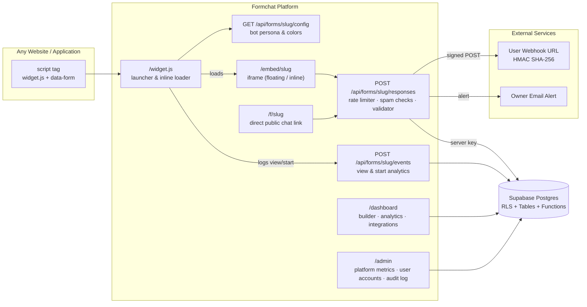

<div align="center">

# Formchat

**Forms that feel like a conversation.**

Build conversational forms, publish them with a public link, embed them on any website as a floating or inline chat widget, automate workflows via webhooks, and analyze responses with real-time conversion funnels.

[](https://nextjs.org)
[](https://react.dev)
[](https://www.typescriptlang.org)
[](https://tailwindcss.com)
[](https://supabase.com)
[](https://nodejs.org)
[](https://vercel.com)

**[Live demo](https://formchat-five.vercel.app)** · **[Test website with the widget](https://formchat-test-mash.netlify.app/)** · **[Report a bug](https://github.com/mash-yk/formchat/issues)**


</div>

---

## Contents

- [Key Features](#features)
  - [1. Advanced Form Builder](#1-advanced-form-builder)
  - [2. Enhanced Chatbot Widget](#2-enhanced-chatbot-widget)
  - [3. Real-Time Analytics Dashboard](#3-real-time-analytics-dashboard)
  - [4. Webhooks & Email Notifications](#4-webhooks--email-notifications)
  - [5. Administrative Portal & RBAC](#5-administrative-portal--rbac)
  - [6. Security & Anti-Spam Protection](#6-security--anti-spam-protection)
- [Screenshots](#screenshots)
- [How It Works](#how-it-works)
- [Tech Stack](#tech-stack)
- [Architecture](#architecture)
- [Data Model & Schema](#data-model--schema)
- [Getting Started](#getting-started)
- [Database Migrations](#database-migrations)
- [Automated Testing](#automated-testing)
- [Embedding the Widget](#embedding-the-widget)
- [Deployment](#deployment)
- [Project Structure](#project-structure)
- [Theming](#theming)
- [Author](#author)

---

## Features

### 1. Advanced Form Builder
- **8 Question Types**: Text, Email, Yes/No, Multiple Choice, Dropdown, Rating (1–5 / 1–10 stars or numbers), Date picker, and File upload (with type filtering and size caps up to 10 MB).
- **Conditional Branching Logic**: Dynamically show or hide questions based on prior answers (`equals`, `not_equals`, `contains`, `is_answered`).
- **5 Curated Form Templates**: Quick-start templates for Customer Satisfaction (CSAT/NPS), Event RSVP, Job Application, Product Feedback, and Bug Report.
- **Form Duplication**: 1-click cloning of forms and questions into a new draft.
- **Local Autosave & Draft Recovery**: Builder state is saved to `localStorage` every 30 seconds with a recovery prompt if an unsaved session is detected.
- **Advanced Validation**: Configurable min/max character lengths, required toggle, option constraints, and regex-safe text.
- **Custom Success Actions**: Custom post-submission completion messages and optional URL redirection.
- **Multi-Device Live Preview**: Interactive preview toggleable between Desktop, Tablet, and Mobile viewport frames.

### 2. Enhanced Chatbot Widget
- **Avatar & Bot Persona**: Choose custom bot names and choose from 5 avatar styles (`robot`, `sparkles`, `agent`, `chat`, `smile`) or custom image URLs.
- **Dual Display Modes**:
  - **Floating Launcher**: Classic bottom-right or bottom-left launcher with unread pulse and mobile-responsive expansion.
  - **Inline Embed**: Clean card-based embed (`data-mode="inline"`) that seamlessly mounts anywhere inside your page layout.
- **Dynamic Micro-Interactions**: Realistic bot typing indicators with auto-scrolling message streams.
- **Progress Tracking**: Real-time progress bar with completed question counter.
- **Session Control**: Restart conversation option to clear previous answers and start fresh.

### 3. Real-Time Analytics Dashboard
- **Funnel Metrics**: Track total Views, Conversation Starts, Submissions, Completion Rate, and Abandonment Rate.
- **Date Range Filtering**: Analyze performance across 7 days, 30 days, 90 days, or all-time.
- **Daily Trend Chart**: Visual SVG bar chart showing daily starts versus completions.
- **Question-Level Breakdown**: Detailed response statistics including average ratings for rating fields, option distribution percentages for choices/dropdowns, and sample responses for text/email.
- **Data Export**: 1-click RFC 4180-compliant CSV export with formula injection sanitization.

### 4. Webhooks & Email Notifications
- **Webhooks with HMAC SHA-256**: Real-time POST delivery to user-configured webhook URLs with cryptographic signature headers (`X-Formchat-Signature`, `X-Formchat-Event`, `X-Formchat-Timestamp`).
- **Test Webhook Ping**: Verify endpoint connectivity directly from the Integrations dashboard with live latency and HTTP response reporting.
- **Delivery Audit Logs**: In-memory and persisted status logs for webhook dispatches.
- **Email Notifications**: Instant email alerts sent to the form owner upon every response.

### 5. Administrative Portal & RBAC
- **Platform Analytics**: Total users, total forms, total responses, and 24h submission activity.
- **User Account Management**: Search users by email or ID, view assigned roles (`admin` / `user`), and monitor registration dates.
- **Account Suspension & Reactivation**: Immediate enforcement blocking form submissions and API operations for suspended accounts.
- **System Activity Audit Trail**: Comprehensive audit logs tracking critical actions (form creations, status changes, suspensions, webhooks).
- **Role-Based Access Control**: Configured securely via `ADMIN_EMAILS` environment variable.

### 6. Security & Anti-Spam Protection
- **Multi-Tenant Row Level Security (RLS)**: Enforced across all Supabase Postgres tables (`forms`, `questions`, `responses`, `form_events`).
- **Sliding-Window Rate Limiting**: In-memory IP rate limiter enforcing a strict 15 submissions per minute threshold.
- **Anti-Spam Bot Detection**:
  - **Honeypot Trap**: Invisible field that immediately catches automated bot scripters.
  - **Speed Check**: Enforces minimum realistic user completion time (> 1200ms) to reject automated script submissions.
- **Server-Only Verification**: All answers re-validated on the server against the question schema before database insertion.

---

## Screenshots

<table>
  <tr>
    <td width="50%"></td>
    <td width="50%"></td>
  </tr>
  <tr>
    <td align="center"><b>Form builder</b> with 8 question types &amp; conditional logic</td>
    <td align="center"><b>Widget</b> embedded on another website</td>
  </tr>
  <tr>
    <td width="50%"></td>
    <td width="50%"></td>
  </tr>
  <tr>
    <td align="center"><b>Responses &amp; Analytics</b> with conversion funnels</td>
    <td align="center"><b>Share &amp; Embed</b>: floating &amp; inline embed modes</td>
  </tr>
  <tr>
    <td width="50%"></td>
    <td width="50%" align="center"></td>
  </tr>
  <tr>
    <td align="center"><b>Dashboard</b> with search, status tabs &amp; duplication</td>
    <td align="center"><b>Mobile</b>: full-screen conversational interface</td>
  </tr>
</table>

---

## How It Works

1. **Pick a Template or Start Blank**: Choose from 5 pre-built templates or build from scratch using 8 question types.
2. **Configure Branching Logic**: Add conditional rules so users only see questions relevant to their prior answers.
3. **Customize Persona & Appearance**: Select bot avatar, display name, brand color, and welcome/completion copy.
4. **Publish & Share**: Deploy with a public link (`/f/{slug}`) or embed using a single `<script>` tag.
5. **Analyze & Automate**: Monitor real-time conversion rates on the Analytics tab and stream leads to your stack via HMAC-signed Webhooks.

---

## Tech Stack

| Layer | Choice |
| :--- | :--- |
| **Framework** | [Next.js 16](https://nextjs.org) (App Router, Server Components, Server Actions, Route Handlers), React 19, TypeScript |
| **Styling** | Tailwind CSS v4 with custom warm espresso and bronze palette |
| **Database & Auth** | [Supabase](https://supabase.com): Postgres, Row Level Security, Supabase Auth |
| **Validation** | [Zod](https://zod.dev) with isomorphic client/server validation schemas |
| **Testing** | Node.js Test Runner with `tsx` (26 unit tests covering core subsystems) |
| **UI Components** | [dnd-kit](https://dndkit.com) (drag-and-drop), [sonner](https://sonner.emilkowal.ski) (toasts), [lucide-react](https://lucide.dev) (icons) |
| **Hosting** | [Vercel](https://vercel.com) |

---

## Architecture



---

## Data Model & Schema

| Table | Key Columns & Notes |
| :--- | :--- |
| `forms` | `id`, `owner_id` (FK `auth.users`), `title`, `description`, `slug` (unique), `status` (`draft` \| `published`), `settings` (`jsonb` containing brand color, messages, redirectUrl, avatar, webhookUrl, webhookSecret, emailNotifications, questionMeta). |
| `questions` | `id`, `form_id` (FK `forms`), `type` (`text`, `email`, `multiple_choice`, `yes_no`, `dropdown`, `rating`, `date`, `file`), `label`, `required`, `options` (`jsonb`), `position`. |
| `responses` | `id`, `form_id` (FK `forms`), `answers` (`jsonb` snapshot with question labels, types, and values), `source` (`link` \| `embed`), `submitted_at`. |
| `form_events` | `id`, `form_id` (FK `forms`), `event_type` (`view` \| `start`), `source` (`link` \| `embed`), `created_at`. Tracks funnel conversion metrics. |

---

## Getting Started

### Prerequisites
- Node.js **20.9+** (Node 22 LTS recommended)
- A [Supabase](https://supabase.com) project

### 1. Clone & Install
```bash
git clone https://github.com/mash-yk/formchat.git
cd formchat
npm install
```

### 2. Run Database Migrations
In your Supabase project's **SQL Editor**, run the following migration scripts in sequential order:
1. [`supabase/migrations/0001_init.sql`](supabase/migrations/0001_init.sql) — Core tables, RLS policies, and grants.
2. [`supabase/migrations/0002_save_form_and_server_submissions.sql`](supabase/migrations/0002_save_form_and_server_submissions.sql) — Transactional `save_form()` routine.
3. [`supabase/migrations/0003_advanced_features.sql`](supabase/migrations/0003_advanced_features.sql) — Extended question types, analytics event tracking, and admin user profiles.

### 3. Configure Environment Variables
Copy `.env.example` to `.env.local`:
```bash
cp .env.example .env.local
```

Fill in the required keys:
```env
NEXT_PUBLIC_SUPABASE_URL=https://your-project.supabase.co
NEXT_PUBLIC_SUPABASE_PUBLISHABLE_KEY=sb_publishable_...
SUPABASE_SECRET_KEY=sb_secret_...
NEXT_PUBLIC_SITE_URL=http://localhost:3000
ADMIN_EMAILS=admin@example.com,your-email@domain.com
```

### 4. Run Development Server
```bash
npm run dev
```
Open [http://localhost:3000](http://localhost:3000) to view the application.

---

## Automated Testing

Formchat includes an automated test suite executed via the native Node.js Test Runner and TypeScript (`tsx`):

```bash
npm test
```

### Test Coverage Highlights:
- **Admin RBAC**: Validates role derivation from `ADMIN_EMAILS`, account suspension, and reactivation locks.
- **Conditional Logic**: Unit tests operator evaluation (`equals`, `not_equals`, `contains`, `is_answered`), order-dependent visibility filtering, and required-answer omission for hidden branches.
- **Integrations**: Tests HMAC-SHA256 signature computation and payload hashing against RFC standards.
- **Rate Limiting & Anti-Spam**: Verifies sliding window rate caps (15/min), honeypot trap detection, and rapid bot submission rejections (< 1200ms).
- **Templates**: Validates template structures, question ID isolation, and default settings.
- **Question Validation**: Exhaustively validates answers for text, emails, yes/no, multiple choice, dropdowns, ratings, dates, and file upload limits.

---

## Embedding the Widget

### 1. Floating Launcher
Add this snippet right before `</body>` on any webpage:

```html
<script 
  src="https://your-domain.com/widget.js" 
  data-form="YOUR_FORM_SLUG" 
  async>
</script>
```

#### Customization Attributes:
- `data-position="left"` — Render launcher on bottom-left (default: `bottom-right`).
- `data-color="#a96325"` — Custom launcher brand color.
- `data-open` — Automatically expand the chat on page load.

### 2. Inline Card Embed
Mount the conversational form inside an existing container or content section:

```html
<div 
  id="formchat-inline" 
  style="width: 100%; max-width: 580px; height: 600px; margin: 0 auto;">
</div>

<script 
  src="https://your-domain.com/widget.js" 
  data-form="YOUR_FORM_SLUG" 
  data-mode="inline" 
  data-target="#formchat-inline" 
  async>
</script>
```

#### JavaScript SDK Controls:
```javascript
window.Formchat.open();    // Opens floating widget
window.Formchat.close();   // Minimizes widget
window.Formchat.toggle();  // Toggles widget state
```

---

## Project Structure

```
src/
├── app/
│   ├── page.tsx                           # Landing page with interactive hero demo
│   ├── (auth)/                            # Login, Signup, Auth Actions
│   ├── admin/                             # Admin dashboard & User management
│   ├── dashboard/                         # User dashboard & Form lists
│   │   ├── actions.ts                     # Form CRUD, duplication, templates, webhooks
│   │   └── forms/[id]/
│   │       ├── builder/                   # Visual builder & preview
│   │       ├── responses/                 # Submission tables & CSV export
│   │       ├── analytics/                 # Conversion funnels & question stats
│   │       ├── integrations/              # Webhook setup & delivery test logs
│   │       └── share/                     # Floating & inline embed configuration
│   ├── f/[slug]/page.tsx                  # Public chat form page
│   ├── embed/[slug]/page.tsx              # Clean iframe host for widget.js
│   └── api/forms/[slug]/
│       ├── responses/route.ts             # Submit: rate limit -> anti-spam -> validate -> save
│       ├── events/route.ts                # Analytics event logger (views & starts)
│       └── config/route.ts                # Widget metadata config endpoint
├── components/
│   ├── chat/chat-form.tsx                 # Core conversational engine (all 8 types)
│   ├── builder/                           # Builder UI, question card, conditional logic
│   ├── dashboard/                         # Form lists, search filters, duplication button
│   ├── analytics/                         # Visual funnel & SVG trend charts
│   ├── integrations/                      # Webhook & email alert settings panel
│   ├── admin/                             # Admin user management table
│   └── ui/                                # Accessible design primitives
├── lib/
│   ├── types.ts                           # Comprehensive TypeScript domain types
│   ├── validation.ts                      # Isomorphic Zod answer & schema validators
│   ├── conditional.ts                     # Branching logic evaluation engine
│   ├── templates.ts                       # 5 pre-built form templates
│   ├── rate-limit.ts                      # Sliding-window rate limiter & anti-spam detection
│   ├── integrations.ts                    # HMAC SHA-256 webhooks & email alerts
│   ├── analytics.ts                       # Funnel & question distribution aggregations
│   ├── admin-core.ts                      # RBAC & suspension enforcement logic
│   └── forms.ts                           # Owner-scoped queries & question hydration
└── proxy.ts                               # Session refresh & route protection
```

---

## Theming

Formchat uses a warm espresso and bronze palette engineered for dark mode elegance with high-contrast accessibility:

- Neutral surfaces: `umber-950` (`#161311`), `umber-900` (`#221d19`), `umber-800` (`#302a24`).
- Metallic accents: `bronze-500` (`#a96325`), `bronze-400` (`#c27632`), `bronze-300` (`#dc924b`).
- The conversational widget adapts gracefully across embedded sites with crisp font rendering and smooth micro-animations.

---

## Author

Built by **[@mash-yk](https://github.com/mash-yk)**. Questions or feedback: [mashrekinyakub02@gmail.com](mailto:mashrekinyakub02@gmail.com).
