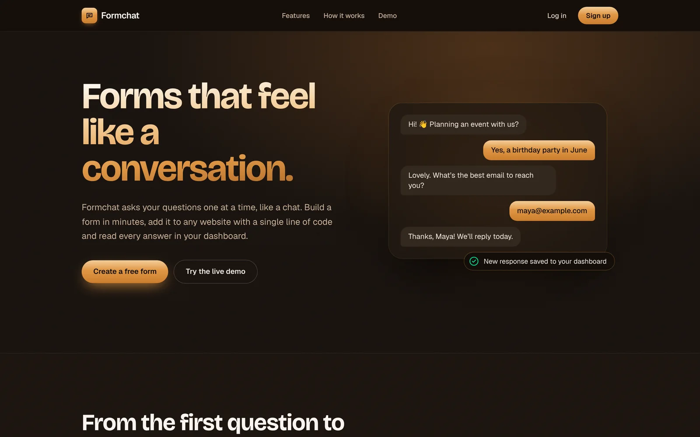
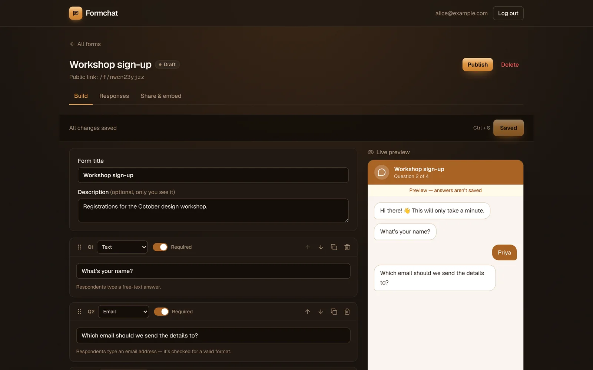
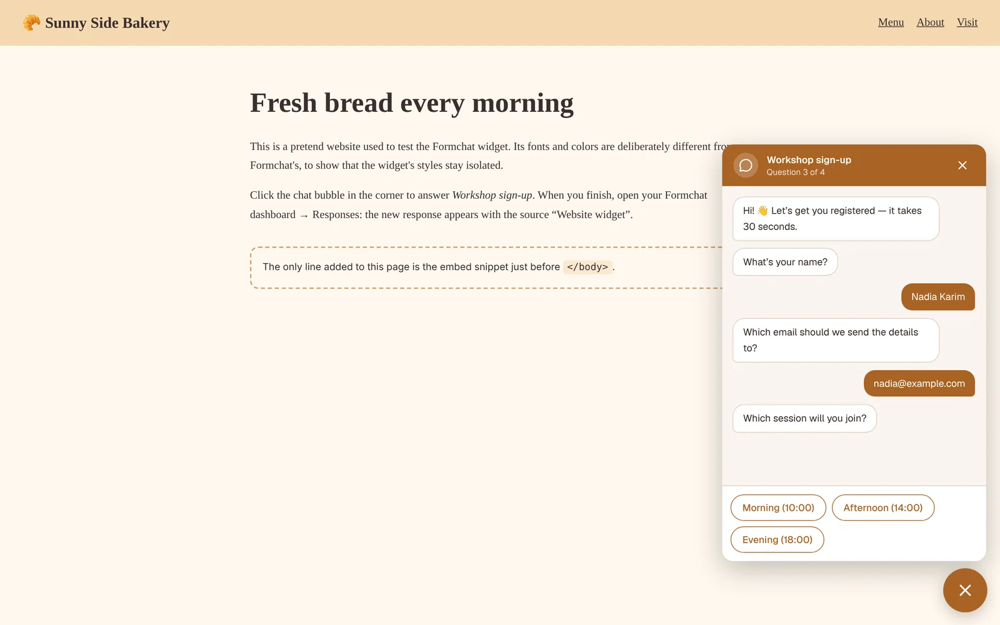
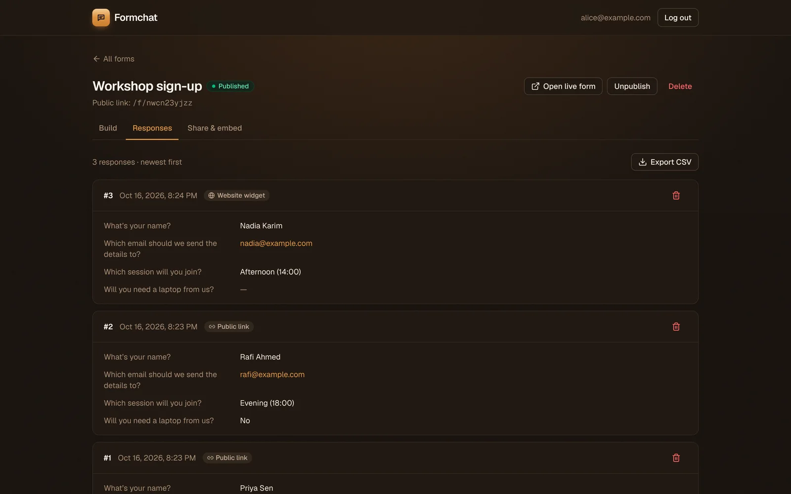
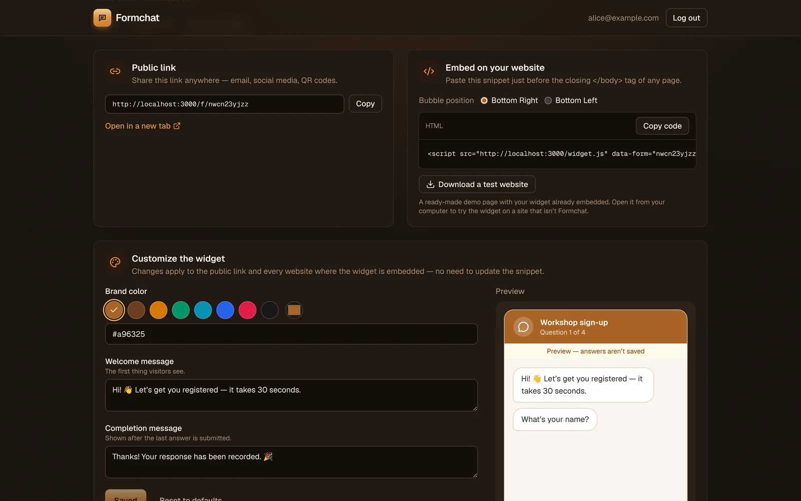
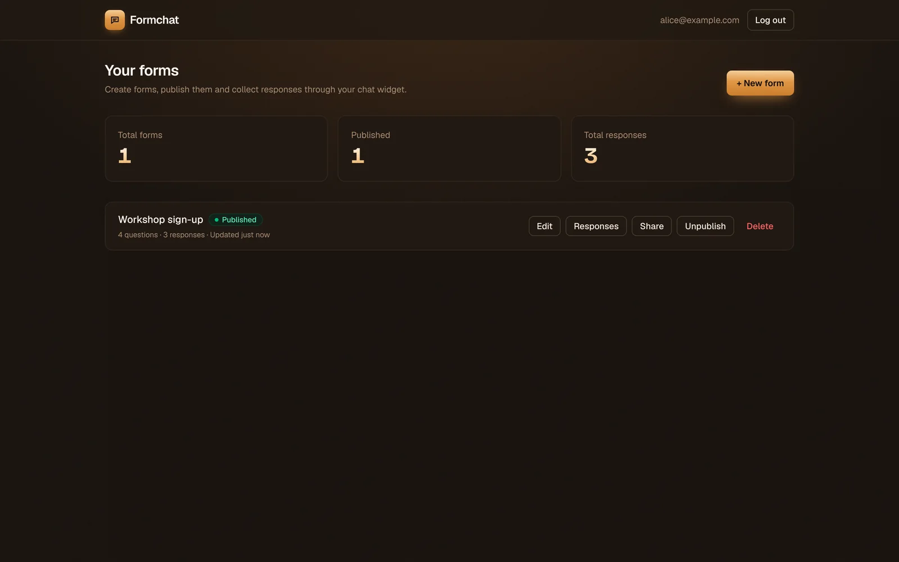
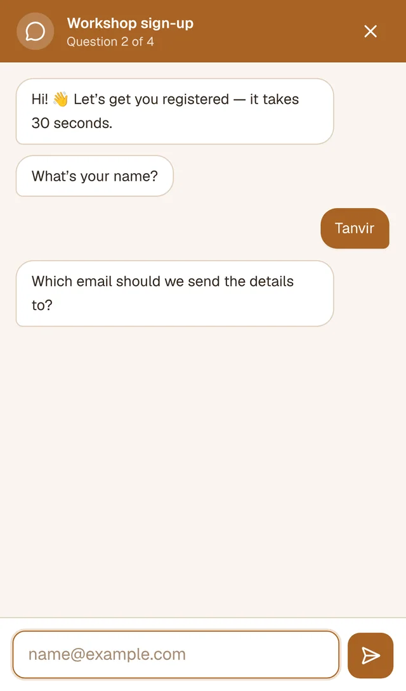
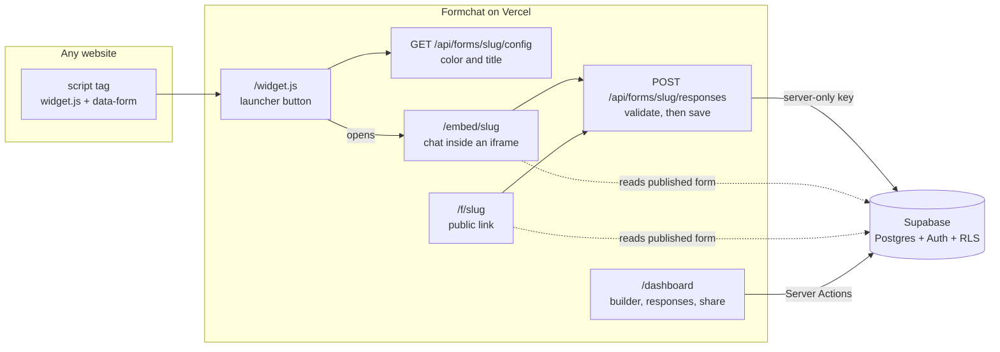

<div align="center">

# Formchat

**Forms that feel like a conversation.**

Build a form, publish it with a public link, embed it on any website as a chat widget, and read every response in one dashboard.

[](https://nextjs.org)
[](https://react.dev)
[](https://www.typescriptlang.org)
[](https://tailwindcss.com)
[](https://supabase.com)
[](https://vercel.com)

**[Live demo](https://YOUR-APP.vercel.app)** · **[Test website with the widget](https://YOUR-TEST-SITE.netlify.app)** · **[Report a bug](https://github.com/mash-yk/formchat/issues)**



</div>

---

## Contents

- [Features](#features)
- [Screenshots](#screenshots)
- [How it works](#how-it-works)
- [Tech stack](#tech-stack)
- [Architecture](#architecture)
- [Getting started](#getting-started)
- [Deployment](#deployment)
- [Embedding the widget](#embedding-the-widget)
- [Security](#security)
- [Project structure](#project-structure)
- [Theming](#theming)
- [Known limitations](#known-limitations)

## Features

**Form builder**

- Four question types: text, email, multiple choice and yes/no
- Edit, duplicate and delete questions; reorder them by drag-and-drop or the arrow buttons
- Mark questions as required or optional
- Live chat preview that updates as you type
- Validation (empty questions, duplicate options), an unsaved-changes guard and <kbd>Ctrl</kbd> + <kbd>S</kbd> to save

**Chat widget**

- Asks one question at a time, with typing indicators
- Text and email inputs, tap-to-answer buttons, and **Skip** for optional questions
- Inline validation: required answers, valid email addresses, allowed options
- Custom welcome and completion messages and brand color
- A floating launcher on desktop; full screen on phones

**Publishing and sharing**

- Unique public link per form (`/f/{slug}`)
- One-line embed snippet for any website
- A **Download a test website** button that generates a demo page with your widget already embedded
- Publish and unpublish at any time; unpublished widgets hide themselves on host sites

**Responses**

- Stored in Postgres with submission timestamps (shown in the viewer's time zone) and source (public link or website widget)
- Paginated list, delete and **CSV export**
- Answers are snapshotted, so editing a form never breaks old responses

**Dashboard**

- Totals for forms, published forms and responses
- Create, edit, publish/unpublish and delete forms

## Screenshots

<table>
  <tr>
    <td width="50%"></td>
    <td width="50%"></td>
  </tr>
  <tr>
    <td align="center"><b>Form builder</b> with live preview</td>
    <td align="center"><b>Widget</b> embedded on another website</td>
  </tr>
  <tr>
    <td width="50%"></td>
    <td width="50%"></td>
  </tr>
  <tr>
    <td align="center"><b>Responses</b> with timestamps and source</td>
    <td align="center"><b>Share &amp; embed</b>: link, snippet, colors and messages</td>
  </tr>
  <tr>
    <td width="50%"></td>
    <td width="50%" align="center"></td>
  </tr>
  <tr>
    <td align="center"><b>Dashboard</b></td>
    <td align="center"><b>Mobile</b>: full-screen chat</td>
  </tr>
</table>

## How it works

1. **Build.** Sign up, click **New form**, add questions and save.
2. **Publish.** The form gets a public link.
3. **Embed.** Copy one `<script>` line from **Share & embed** into any website. A chat bubble appears in the corner.
4. **Collect.** Visitors answer one question at a time. Each answer is validated in the browser and again on the server.
5. **Review.** Responses appear in the dashboard with the time they were submitted and where they came from.

## Tech stack

| Layer           | Choice                                                                                                                                   |
| --------------- | ---------------------------------------------------------------------------------------------------------------------------------------- |
| Framework       | [Next.js 16](https://nextjs.org) (App Router, Server Components, Server Actions, Route Handlers, Cache Components), React 19, TypeScript |
| Styling         | Tailwind CSS v4 with a custom espresso and bronze palette                                                                                |
| Database & auth | [Supabase](https://supabase.com): Postgres, email/password Auth, Row Level Security                                                      |
| Validation      | [Zod](https://zod.dev), with the same rules in the browser and on the server                                                             |
| UI libraries    | [dnd-kit](https://dndkit.com) (drag-and-drop), [sonner](https://sonner.emilkowal.ski) (toasts), [lucide](https://lucide.dev) (icons)     |
| Hosting         | [Vercel](https://vercel.com)                                                                                                             |

## Architecture



**Design decisions**

- **One chat component everywhere.** The builder preview, public link, embedded widget, share-page preview and landing demo all render `src/components/chat/chat-form.tsx`. Its transcript is derived from state, so the builder preview updates while you edit.
- **The widget is an iframe.** `widget.js` is dependency-free JavaScript. It adds a launcher and lazily loads `/embed/{slug}` in an iframe, so the host site's CSS and the widget's CSS never collide, and submissions are same-origin (no CORS). Only `/embed/*` may be framed by other sites; every other page sends `X-Frame-Options: SAMEORIGIN`.
- **Answer snapshots.** Each response stores the question label and type alongside the answer, so edited or deleted questions never break old responses or the CSV export.
- **Atomic saves.** The builder saves the title, description and every question through one Postgres function (`save_form`) in a single transaction. Question ids are preserved.

### Data model

| Table       | Key columns                                                                                                                                  |
| ----------- | -------------------------------------------------------------------------------------------------------------------------------------------- |
| `forms`     | `owner_id` → `auth.users`, `title`, `description`, `slug` (unique), `status` (`draft` / `published`), `settings` (jsonb: color and messages) |
| `questions` | `form_id` → `forms`, `type`, `label`, `required`, `options` (jsonb), `position`                                                              |
| `responses` | `form_id` → `forms`, `answers` (jsonb snapshot), `source` (`link` / `embed`), `submitted_at`                                                 |

## Getting started

### Prerequisites

- Node.js **20.9+**
- A free [Supabase](https://supabase.com) project

### 1. Clone and install

```bash
git clone https://github.com/mash-yk/formchat.git
cd formchat
npm install
```

### 2. Create the database

In the Supabase dashboard, open **SQL Editor** and run these files **in order**. Each should report "Success. No rows returned".

1. [`supabase/migrations/0001_init.sql`](supabase/migrations/0001_init.sql): tables, indexes, grants and RLS policies
2. [`supabase/migrations/0002_save_form_and_server_submissions.sql`](supabase/migrations/0002_save_form_and_server_submissions.sql): the `save_form()` function and server-only submissions

### 3. Configure auth

Go to **Authentication → URL Configuration**:

- **Site URL:** `http://localhost:3000`
- **Redirect URLs:** add `http://localhost:3000/**`

> [!TIP]
> For local testing, turn off **Confirm email** under **Authentication → Sign In / Providers → Email**. Supabase's built-in email sender only allows a few emails per hour.

### 4. Environment variables

```bash
cp .env.example .env.local
```

| Variable                               | Where to find it                                                               |
| -------------------------------------- | ------------------------------------------------------------------------------ |
| `NEXT_PUBLIC_SUPABASE_URL`             | Supabase **Connect** button → Project URL                                      |
| `NEXT_PUBLIC_SUPABASE_PUBLISHABLE_KEY` | Supabase **Connect** button → publishable key (`sb_publishable_…`)             |
| `SUPABASE_SECRET_KEY`                  | **Project Settings → API Keys → Secret keys** (`sb_secret_…`)                  |
| `NEXT_PUBLIC_SITE_URL`                 | `http://localhost:3000` locally, your production URL when deployed             |
| `NEXT_PUBLIC_DEMO_FORM_SLUG`           | _Optional._ A published form's slug, so the landing page shows the real widget |

> [!CAUTION]
> `SUPABASE_SECRET_KEY` bypasses Row Level Security. Never commit it and never prefix it with `NEXT_PUBLIC_`. `.env.local` is already git-ignored.

### 5. Run

```bash
npm run dev
```

Open <http://localhost:3000>, sign up and create your first form.

### Scripts

| Command             | What it does                            |
| ------------------- | --------------------------------------- |
| `npm run dev`       | Start the development server            |
| `npm run build`     | Production build                        |
| `npm run start`     | Serve the production build              |
| `npm run lint`      | ESLint                                  |
| `npm run typecheck` | Generate route types and run TypeScript |
| `npm run format`    | Format with Prettier                    |

## Deployment

1. Push the repository to GitHub.
2. In [Vercel](https://vercel.com/new), import the repo. The framework is detected automatically.
3. Add `NEXT_PUBLIC_SUPABASE_URL`, `NEXT_PUBLIC_SUPABASE_PUBLISHABLE_KEY` and `SUPABASE_SECRET_KEY` (mark it as _Secret_), then click **Deploy**.
4. Add `NEXT_PUBLIC_SITE_URL` with your production URL and **redeploy**. Environment-variable changes only apply to new deployments.
5. In Supabase → **Authentication → URL Configuration**, set **Site URL** to the production URL and add `https://your-app.vercel.app/**` to **Redirect URLs**.

To show the widget on a site other than Formchat, open **Share & embed**, click **Download a test website**, rename the file to `index.html` and drop its folder onto [Netlify Drop](https://app.netlify.com/drop) (sign in so the site doesn't expire).

## Embedding the widget

Paste the snippet from **Share & embed** just before `</body>`:

```html
<script src="https://your-app.vercel.app/widget.js" data-form="YOUR_FORM_SLUG" async></script>
```

| Attribute              | Description                                                   |
| ---------------------- | ------------------------------------------------------------- |
| `data-form`            | **Required.** The form's slug                                 |
| `data-position="left"` | Put the launcher bottom-left (default: bottom-right)          |
| `data-color="#e11d48"` | Override the launcher color (default: the form's brand color) |
| `data-open`            | Open the chat automatically on page load                      |

Control the widget from your own code with `window.Formchat.open()`, `window.Formchat.close()` and `window.Formchat.toggle()`.

A ready-to-edit example lives in [`examples/test-site/index.html`](examples/test-site/index.html).

## Security

- **Row Level Security** on every table. Owners can only read and change their own forms, questions and responses. Visitors can only read _published_ forms.
- **Server-only submissions.** Browsers cannot insert responses directly. `POST /api/forms/{slug}/responses` reloads the form, re-validates every answer with the same Zod rules the chat uses, and only then inserts with the server-only secret key (`src/lib/supabase/admin.ts`, guarded by `server-only`).
- **Owner-filtered queries.** Published forms are publicly readable, so dashboard queries also filter by `owner_id`, defense in depth on top of RLS.
- **Auth everywhere.** `src/proxy.ts` (Next.js 16's middleware) redirects signed-out users, and every protected page, Server Action and Route Handler also calls `requireUser()`.
- **Abuse basics.** A honeypot field, JSON-only submissions, a body-size limit, a 2,000-character answer cap, CSV formula-injection protection and unguessable 10-character slugs.
- **Explicit Data API grants.** New Supabase projects no longer expose tables automatically, so the migrations grant each role only what it needs.

## Project structure

```
src/
├── app/
│   ├── page.tsx                          # landing page
│   ├── (auth)/                           # login, signup, auth Server Actions
│   ├── auth/confirm/route.ts             # email confirmation link
│   ├── dashboard/
│   │   ├── page.tsx                      # stats + forms list
│   │   ├── actions.ts                    # all dashboard Server Actions
│   │   └── forms/[id]/                   # builder · responses (+ CSV) · share & embed
│   ├── f/[slug]/page.tsx                 # public form link
│   ├── embed/[slug]/page.tsx             # iframe target for widget.js
│   └── api/forms/[slug]/
│       ├── responses/route.ts            # submit: validate → save
│       └── config/route.ts               # launcher config for widget.js
├── components/
│   ├── chat/chat-form.tsx                # the chat engine, used everywhere
│   ├── builder/                          # reducer, question card, builder UI
│   └── dashboard/ · share/ · landing/ · ui/
├── lib/
│   ├── validation.ts                     # Zod schemas + answer validation (shared)
│   ├── forms.ts                          # data access (owner-filtered)
│   └── supabase/                         # browser · server · proxy · public · admin clients
└── proxy.ts                              # session refresh + redirects
public/widget.js                          # embed loader (plain JS)
supabase/migrations/                      # schema, RLS, functions
examples/test-site/                       # sample external website
```

## Theming

The espresso and bronze palette is defined once in [`src/app/globals.css`](src/app/globals.css):

- **`umber-*`** (warm brown neutrals) for surfaces, borders and text. **`bronze-*`** (metallic accent) for buttons, links and focus rings.
- `bg-bronze-metal` and `text-bronze-metal` utilities add the metallic gradient; `grain` adds the subtle film texture.
- The UI is always dark (class-based `dark:` variant). The chat widget stays light so it fits on any host website, with bronze `#a96325` as its default color.
- Text and background pairs meet WCAG AA contrast.

## Known limitations

- No rate limiting on the submit endpoint yet. It could use Vercel KV / Upstash or a Postgres-based limiter.
- No conditional logic or extra question types (number, date, rating).
- No email notifications for new responses.
- The response list has no search or filters.

## Author

Built by **[@mash-yk](https://github.com/mash-yk)** as a full-stack internship project. Questions or feedback: [mashrekinyakub02@gmail.com](mailto:mashrekinyakub02@gmail.com).
